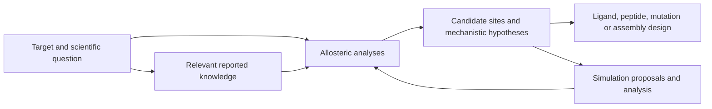

# Architecture discussion notes

**Status:** provisional interpretations for negotiation, not an agreed software
architecture. **Current phase:** researcher-needs elicitation under
[AlloMT #3](https://github.com/uibcdf/allomt/issues/3).

Read [the researcher's needs](RESEARCHER_NEEDS.md) and
[the discussion record](DESIGN_DISCUSSION.md) first. No source-module tree,
domain class hierarchy, public API, backend or scientific result schema is
selected by this document. The implementation remains the minimal source scaffold.

## Product journey to explore

The needs suggest several useful entry points: discovering candidate sites,
investigating a known site/mechanism, retrieving reported ligands, analyzing
existing simulations, planning experiments, and designing interventions. The
following is one illustrative journey, not a compulsory pipeline or runtime graph.

Whether and how these activities share contracts, data and reusable operations
is part of the negotiation. An entry point should not be assumed to require an
online query or a complete campaign merely because that is shown in one journey.

## Design dimensions raised by the needs

| Dimension to investigate | Needs motivating it | Open questions |
| --- | --- | --- |
| Target, assembly, conformations and functional reference | N01, N08, N10, N12 | Q01, Q02 |
| Reported knowledge and experimental context | N01, N03 | Q03 |
| Candidate sites, perturbations and signed functional predictions | N01, N04, N08, N13 | Q02, Q05, Q09 |
| Mechanisms, communication paths and resolution | N02, N05 | Q04, Q06 |
| Experiment proposals and existing-trajectory analysis | N05, N08, N12 | Q06 |
| Third-party/native methods and ML/AI | N04, N06, N07 | Q05, Q07 |
| Molecular/peptide design, selectivity and assembly modulation | N09, N10, N11, N12 | Q08, Q09 |
| Composable scientific operations and workflow entry points | N01–N13 | Q01, Q08, Q10 |

These are discussion dimensions, not proposed Python package names. Their
boundaries and granularity should follow the negotiated needs and concrete cases.

## Existing ecosystem constraints

The [ecosystem map](ECOSYSTEM.md) and canonical MolSysSuite guide retain their
authority for provider ownership. Molecular representation and shared structural
operations belong to MolSysMT; elastic-network numerical work is coordinated
with ElastNetMT; pharmacophore, binding, peptide and visualization capabilities
retain their existing owners. Sabueso supplies scientific knowledge through its
own contracts. Requested integrations do not establish that every required API
is already implemented or that new runtime dependencies have been selected.

AlloMT's methods and workflows should remain usable through its own scientific
interfaces, while MolI/Praxis/agent hosts can compose them under their contracts.
Cross-component requirements are reported to their owners through linked issues.
No new cross-component contract is imposed by these notes.

## Proposals and decisions

The initial interpretations I01–I05 are recorded in
[R01](DESIGN_DISCUSSION.md#r01--researcher-vision-and-discussion-process-2026-11-15).
None is yet an agreed architecture. Subsequent rounds will identify which
concepts, operations and result meanings are necessary, refine this document,
and record the rationale for accepted, revised or withdrawn proposals.
